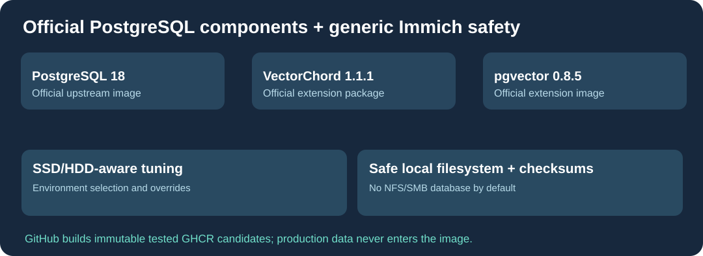

# Cloud9-Immich-Postgres

**Image PostgreSQL 18 générique pour [Immich](https://github.com/immich-app/immich), compilée sur GitHub à partir des composants officiels et distribuée via GHCR.**

[English](README.md) · Français · [简体中文](README.zh-CN.md)

Ajouts par rapport à PostgreSQL pur : extensions **VectorChord 1.1.1** et **pgvector 0.8.5** ; configurations de stockage **SSD/HDD** sélectionnées automatiquement ; refus des bases sur NFS/SMB et systèmes de fichiers incompatibles ; prise en charge des secrets via fichiers ; contrôles de disponibilité et des erreurs de checksum. Les paramètres propres à une machine restent séparés et ne sont pas codés dans l'image.

GitHub construit les images amd64/arm64, vérifie leur fonctionnement, puis prépare une image GHCR candidate immuable. Aucune base de données privée, identité, clé ou chemin personnel n'est distribué.

**Migration :** conserver le même PostgreSQL majeur et les mêmes extensions avant toute substitution. Sauvegarder et tester les données Immich sur une copie avant de remplacer l'image. Aucune promotion automatique de latest ni bascule de production sans tests E2E.

Scripts et packaging dérivés d'Immich sous **AGPL-3.0** ; extensions et moteur conservent leurs licences upstream.
