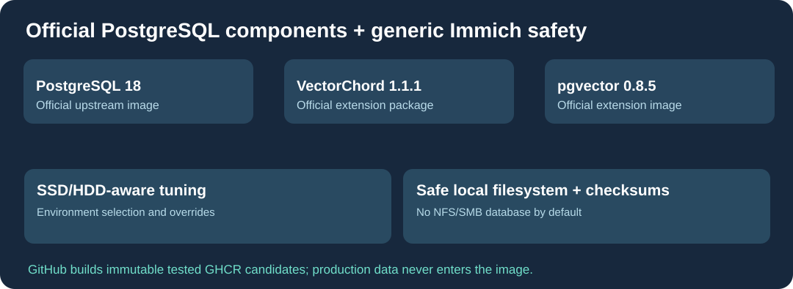

# Cloud9-Immich-Postgres

**Generic, security-focused [Immich](https://github.com/immich-app/immich) PostgreSQL 18 image, built on GitHub from official PostgreSQL, pgvector and VectorChord.**

English · [Français](README.fr.md) · [简体中文](README.zh-CN.md)

## Extra functions over a stock postgres image

- PostgreSQL **18**, [pgvector 0.8.5](https://github.com/pgvector/pgvector), and [VectorChord 1.1.1](https://github.com/tensorchord/VectorChord) in one supported Immich-compatible image.
- **SSD/HDD-aware configuration**, selected with DB_STORAGE_TYPE=SSD or HDD and compatible with additional operator override files.
- **Database filesystem safety:** refuse NFS/SMB and other unsupported filesystem types unless deliberately overridden by the operator; use local Linux filesystems for actual database storage.
- **Non-destructive environment secret-file support**, readiness healthcheck and Postgres checksum-failure monitoring.
- **GitHub-built immutable GHCR candidates** instead of local compilation; build failures never automatically affect production.

The image contains **no user data, passwords, home paths or internal domains**. The database and its WAL must be mounted on a supported persistent local filesystem.

## Compatible baseline and updates

This packaging preserves the known production extension interface **PG18 / VectorChord 1.1.1 / pgvector 0.8.5**. GitHub builds/test images for amd64/arm64 from upstream official components. Before switching an existing Immich database, verify its PG major, extension versions, storage, backups and full API functionality. A major PostgreSQL version migration cannot be accomplished with an image pull.

No latest promotion or live deployment occurs without E2E validation.

License and credits: Immich-derived runtime scripts and packaging follow **AGPL-3.0**. PostgreSQL and bundled extensions keep their respective upstream licenses. Independent Cloud9 community distribution.
