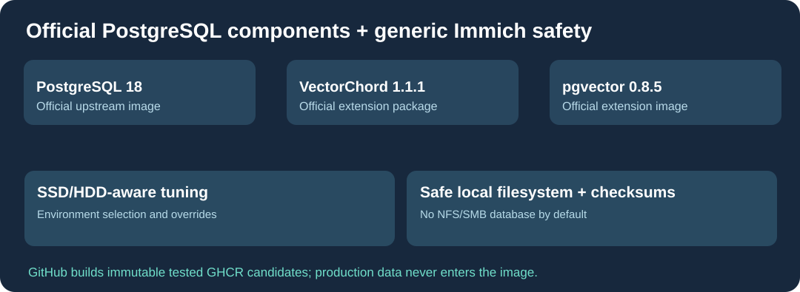

# Cloud9-Immich-Postgres

**基于官方 [Immich](https://github.com/immich-app/immich) 数据库组件的通用 PostgreSQL 18 Docker 镜像，使用 GitHub 构建 GHCR 镜像。**

[English](README.md) · [Français](README.fr.md) · 简体中文

功能包括：PostgreSQL **18**、VectorChord **1.1.1** 与 pgvector **0.8.5**；根据 DB_STORAGE_TYPE 自动选择 SSD/HDD 配置；默认拒绝在 NFS/SMB 等不安全文件系统上创建数据库；支持密钥文件；数据库就绪及校验和错误监控。

GitHub Actions 构建 amd64/arm64 镜像并验证 PostgreSQL 与扩展功能，只发布不可变的 GHCR 候选版本，不直接修改生产环境。

镜像和公开仓库**不包含用户数据库、账号、密钥、私人路径或网络地址**。正式升级前必须备份数据库和 WAL，核实 PostgreSQL 主版本与扩展版本，并在隔离副本上测试 Immich 兼容性。不能用简单拉取镜像代替数据库版本升级。

部分来自 Immich 的脚本与包装遵循 **AGPL-3.0**，PostgreSQL 和扩展保留原始许可证。
